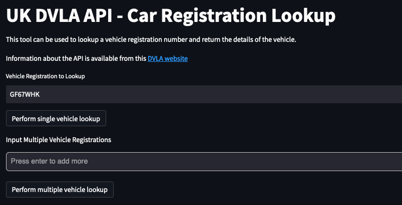
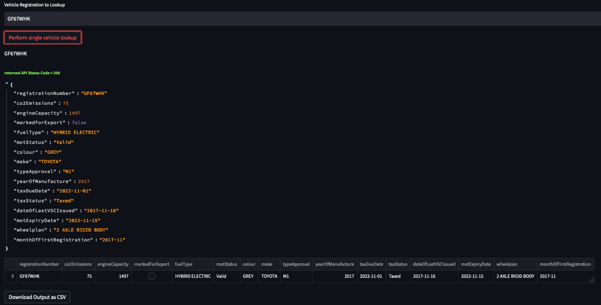
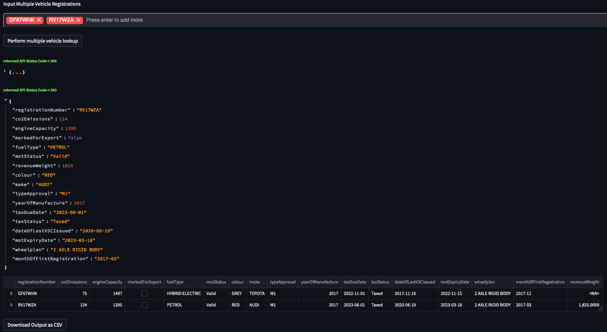

# UK Vehicle Lookup from Registration

A simple [Streamlit](https://streamlit.io/) app that looks up UK vehicles by registration number using the DVLA
[Vehicle Enquiry Service (VES) API](https://developer-portal.driver-vehicle-licensing.api.gov.uk/apis/vehicle-enquiry-service/vehicle-enquiry-service-description.html).



## Features

- **Single lookup**: a summary (make, colour, year, tax and MOT status) plus every returned field and the raw JSON.
- **Multiple lookup**: paste registrations one per line or comma separated, or upload a `.txt`/`.csv` file. Duplicates are removed and up to 100 are looked up per batch, with a progress bar.
- Input is tidied before it is sent: `ab12 cde` becomes `AB12CDE`. Invalid formats are rejected without calling the API.
- Clear error messages for each failure (not found, bad API key, rate limited, service down or network error). In a batch, failures are listed separately and don't stop the run.
- Results are cached for an hour and survive reruns, so clicking **Download results as CSV** doesn't clear the page.
- A UAT/test environment toggle for DVLA test keys.

## Getting an API key

Register for a key at the [DVLA VES registration page](https://register-for-ves.driver-vehicle-licensing.api.gov.uk/).
**Never commit your key.** The app reads it from (in order):

1. `.streamlit/secrets.toml`: copy `.streamlit/secrets.toml.example` and fill it in (this file is git-ignored)
2. the `DVLA_API_KEY` environment variable
3. the password box in the sidebar, if neither of the above is set

## Running locally

```bash
python -m venv .venv
# Windows: .venv\Scripts\activate    macOS/Linux: source .venv/bin/activate
pip install -r requirements.txt
streamlit run app.py
```

## Running with Docker

```bash
docker build -t uk-vehicle-lookup .
docker run --rm -p 8501:8501 -e DVLA_API_KEY=your-key uk-vehicle-lookup
```

Then open <http://localhost:8501>.

## How it works

- `dvla.py` is a small API client with no Streamlit code in it. It normalises and validates the registration, then
  POSTs `{"registrationNumber": "..."}` as JSON with the `x-api-key` header and a timeout. It returns a `LookupResult`
  with either the vehicle data or a readable error, taken from the API's `errors[].detail` field where available.
- `app.py` is the Streamlit UI. It flattens the JSON responses into a pandas DataFrame with `pd.json_normalize`,
  puts the most useful columns first, and offers the table as a CSV download.




## Tests

```bash
pip install -r requirements-dev.txt
pytest
```

The tests mock the HTTP layer, so they don't need an API key or network access. They also run on GitHub Actions
for every push and pull request.

## Support

No support offered or liability accepted. Use is entirely at your own risk.
